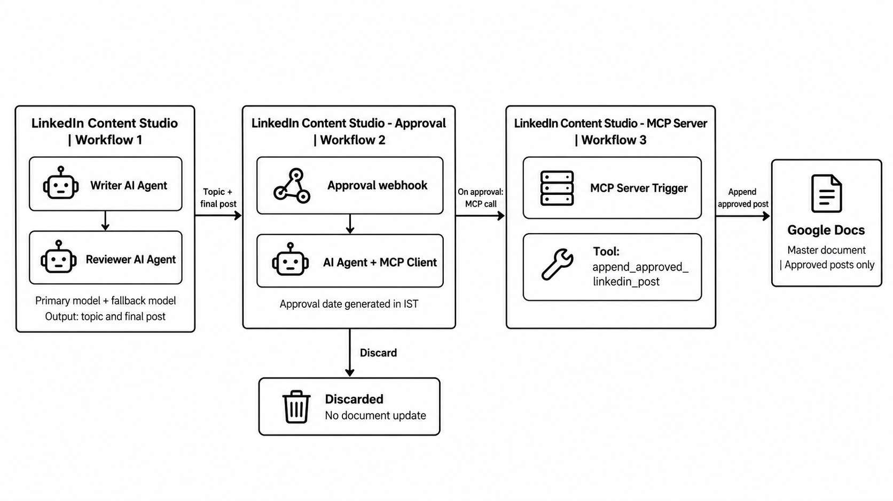

# LinkedIn Content Studio

AI-powered LinkedIn post generation using Writer and Reviewer AI Agents, primary and fallback AI models, human approval, and MCP-based Google Docs integration.

## Architecture

## Demo

[Watch the demo video](https://github.com/user-attachments/assets/a72a99fe-083f-4eb5-a491-758b983335c7)

## Workflows

- **LinkedIn Content Studio:** The Writer AI Agent drafts a post and the Reviewer AI Agent reviews it. A primary AI model with a fallback model supports generation.
- **LinkedIn Content Studio - Approval:** Receives approval or discard decisions. On approval, an AI Agent uses an MCP Client to call the Google Docs tool. The approval date is generated in n8n using India Standard Time (IST). Discarded posts are not saved.
- **LinkedIn Content Studio - MCP Server:** Exposes `append_approved_linkedin_post`, which appends the approved topic, post, and approval date to the master Google Doc.

## Key Concepts

- Writer and Reviewer AI Agents
- Primary and fallback AI models
- Human approval and conditional workflow routing
- MCP Client, MCP Server, and tool calling
- Reliable date handling with IST

## Tech Stack

- **Streamlit:** Post generation and review interface
- **n8n:** Workflow orchestration, AI Agents, webhooks, and model fallback
- **MCP:** Connects the approval workflow to the Google Docs tool
- **Google Docs:** Stores approved posts

*This project stores approved content; it does not publish posts directly to LinkedIn.*
